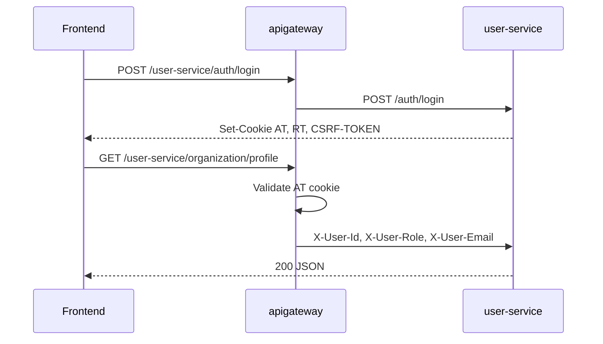

# MealBridge-BE

Backend microservices for **MealBridge** — surplus food matching between organizations and donor institutions. Built with **Spring Boot 3.4**, **Spring Cloud 2024.0.0**, **Eureka**, and **Spring Cloud Gateway**.

## What's implemented

| Area | Status |
|------|--------|
| MSA scaffold (6 modules, Eureka, Gateway routing) | Done |
| Per-service MySQL schemas + Docker Compose | Done |
| JWT auth (HttpOnly cookies), refresh tokens (Redis) | Done |
| Gateway `JwtAuthFilter` + `CsrfFilter` | Done |
| Four roles + RBAC in `user-service` | Done |
| ORGANIZATION / DONOR signup + SUPER_ADMIN approval | Done |
| Sample APIs (`organization`, `donor`, `admin`, `donations/me`) | Done |
| Postman collection for local testing | Done |
| Community-style API envelope (`status_code`, `status_message`, `result`) | Done |
| Kafka, OpenFeign domain flows | Planned |

Architecture follows the **NylonMusk-BE** pattern: the **gateway validates JWT once** and downstream services trust **`X-User-Id`** / **`X-User-Role`** headers.

## API response format (NylonMusk community style)

All servlet services and gateway error responses use the same JSON envelope:

```json
{
  "status_message": "Login successful",
  "status_code": 200,
  "result": { }
}
```

- Success: `com.mealbridge.common.apiResponse.ApiResponse` (`ok`, `created`, …)
- Errors: `CommonErrorDTO` via `CommonExceptionHandler` (services) or `GatewayErrorResponse` (gateway filters)
- Field names are **snake_case** (`status_code`, not `statusCode`)

## Module layout

| Module | Port | Role |
|--------|------|------|
| `eureka` | **8761** (fixed) | Service discovery |
| `apigateway` | **8080** (fixed) | API Gateway, CORS, JWT, routing |
| `user-service` | **0** (random) | Auth, RBAC, user/admin APIs |
| `donation-service` | **0** (random) | Donations (sample endpoint) |
| `matching-service` | **0** (random) | Matching & pickup (scaffold) |
| `ai-service` | **0** (random) | Food scan / nutrition (scaffold) |

Business services use `server.port: 0`. The OS assigns a free port; **Eureka registers the real port**. The gateway resolves services via `lb://service-name`, so fixed ports are not required.

To call a service directly, check the Eureka dashboard (http://localhost:8761) or the service startup log.

Each module is a **standalone Gradle project** (same layout as `be16-fin-3team-NylonMusk-BE`).

## Prerequisites

- **JDK 17+**
- **Docker** (MySQL + Redis for local auth)
- **Git Bash** (optional, for `setup-local-config.sh`)

## Local configuration

`application-local.yml` is **gitignored**. After cloning, generate it once:

```bash
bash scripts/setup-local-config.sh
```

To reset local YAML from examples (e.g. after pulling JWT secret updates):

```bash
bash scripts/setup-local-config.sh --sync
```

**Manual copy (per module):**

```bash
cp apigateway/src/main/resources/application-local.yml.example apigateway/src/main/resources/application-local.yml
cp user-service/src/main/resources/application-local.yml.example user-service/src/main/resources/application-local.yml
# donation-service, matching-service, ai-service — same pattern
```

`eureka` uses `application.yml` only (no `local` profile file).

**Important:** `jwt.secretKeyAt` in `user-service` and `apigateway` must match. Default examples use **HS512-ready 64-byte** secrets (Base64-encoded). Override via `JWT_SECRET_AT` / `JWT_SECRET_RT` only if values are at least 512 bits.

## Infrastructure (local)

```bash
docker compose up -d
bash scripts/setup-local-config.sh --sync
```

| Service | Host | Notes |
|---------|------|--------|
| MySQL | `localhost:3310` | Maps to container `3306`; user/pass `mealbridge` / `mealbridge` |
| Redis | `localhost:6379` | Refresh token store for `user-service` |

### MySQL databases (one instance, four schemas)

| Service | JDBC database |
|---------|----------------|
| `user-service` | `mealbridge_user` |
| `donation-service` | `mealbridge_donation` |
| `matching-service` | `mealbridge_matching` |
| `ai-service` | `mealbridge_ai` |

On first startup, [`docker/mysql/init/01-schemas.sql`](docker/mysql/init/01-schemas.sql) creates all four databases.

If you previously ran an older single-database setup, re-run init:

```bash
docker compose down -v
docker compose up -d
```

## Build (per module)

```bash
cd eureka && ./gradlew build
cd ../apigateway && ./gradlew build
cd ../user-service && ./gradlew build
# donation-service, matching-service, ai-service — same
```

Windows: use `gradlew.bat build`.

## Run order (local)

1. `docker compose up -d`
2. `eureka` (8761)
3. `user-service`, `donation-service`, `matching-service`, `ai-service`
4. `apigateway` (8080)

Activate profile **`local`** in your IDE or:

```bash
./gradlew bootRun --args='--spring.profiles.active=local'
```

### Health checks (via gateway)

- http://localhost:8080/user-service/health
- http://localhost:8080/donation-service/health
- http://localhost:8080/matching-service/health
- http://localhost:8080/ai-service/health

Frontend dev server (CORS allowed): http://127.0.0.1:3000

## Authentication

### Flow



- **Access token (`AT`)** — HttpOnly cookie; validated at the gateway.
- **Refresh token (`RT`)** — HttpOnly cookie; stored in Redis (in-memory fallback in `test` profile).
- **CSRF** — double-submit: cookie `CSRF-TOKEN` + header `X-CSRF-Token` on mutating requests (gateway `CsrfFilter`).

### Roles

| Role | Description |
|------|-------------|
| `ORGANIZATION` | Receiving organization (e.g. welfare center) |
| `DONOR` | Food donor institution (military unit, school, public office, etc.) |
| `SUPER_ADMIN` | Top admin — CRUD for subordinate `ADMIN` accounts |
| `ADMIN` | Sub-admin, created by `SUPER_ADMIN` |

### Registration and approval

1. **Public signup** — `POST /user-service/auth/register/organization` or `/auth/register/donor` → account `PENDING` (no cookies).
2. **SUPER_ADMIN** lists `GET /user-service/admin/registrations/pending`, reviews detail, then `PATCH .../approve` or `.../reject`.
3. After approval, user can **login** normally.

**ADMIN accounts** are not self-registered; `SUPER_ADMIN` creates them via `POST /user-service/admin/users`.

### Authorization (NylonMusk community header pattern)

- **API Gateway** validates JWT (cookies) and injects `X-User-Id` / `X-User-Role` on downstream requests.
- **user-service** has no Spring Security filter chain. Protected controllers call `AuthHeaders` (same idea as NylonMusk community): missing or invalid headers → `SecurityException` → **403** with `CommonErrorDTO`.
- **Role checks** are explicit per endpoint (`requireSuperAdmin`, `requireAdmin`, `requireOrganization`, `requireDonor`, `requireActiveUser`).
- **donation-service** uses a lightweight `AuthHeaders` copy (no user DB); sample `GET /donations/me` requires `ORGANIZATION` or `DONOR`.
- Direct calls to a service **without** going through the gateway skip JWT validation — rely on network policy in production.

### Gateway API reference (prefix `/user-service`)

| Method | Path | Access |
|--------|------|--------|
| POST | `/user-service/auth/register/organization` | Public |
| POST | `/user-service/auth/register/donor` | Public |
| POST | `/user-service/auth/login` | Public |
| POST | `/user-service/auth/refresh` | Public (valid `RT` cookie) |
| POST | `/user-service/auth/logout` | Authenticated |
| GET | `/user-service/admin/registrations/pending` | `SUPER_ADMIN` |
| GET | `/user-service/admin/registrations/{userId}` | `SUPER_ADMIN` |
| PATCH | `/user-service/admin/registrations/{userId}/approve` | `SUPER_ADMIN` |
| PATCH | `/user-service/admin/registrations/{userId}/reject` | `SUPER_ADMIN` |
| GET | `/user-service/organization/profile` | `ORGANIZATION` |
| GET | `/user-service/donor/profile` | `DONOR` |
| GET | `/user-service/admin/users` | `SUPER_ADMIN` |
| POST | `/user-service/admin/users` | `SUPER_ADMIN` |
| PATCH | `/user-service/admin/users/{id}/status` | `SUPER_ADMIN` |
| GET | `/user-service/admin/users/me` | `ADMIN` |
| GET | `/donation-service/donations/me` | `DONOR` (sample; role checked in service) |

### Frontend integration

- Send cookies: `credentials: 'include'`
- On POST/PUT/PATCH/DELETE: header `X-CSRF-Token` = cookie `CSRF-TOKEN` value
- Do not set `X-User-Id` / `X-User-Role` from the client — the gateway sets them after JWT validation

### Seed users (`mealbridge.auth.seed-enabled=true`, `local` profile)

| Email | Role | Password |
|-------|------|----------|
| `super@mealbridge.local` | `SUPER_ADMIN` | `mealbridge123!` |
| `admin@mealbridge.local` | `ADMIN` | `mealbridge123!` |
| `org@mealbridge.local` | `ORGANIZATION` | `mealbridge123!` |
| `donor@mealbridge.local` | `DONOR` | `mealbridge123!` |

## Postman

Import:

- [`postman/MealBridge-Local.postman_collection.json`](postman/MealBridge-Local.postman_collection.json)
- [`postman/MealBridge-Local.postman_environment.json`](postman/MealBridge-Local.postman_environment.json)

Details: [`postman/README.md`](postman/README.md).

Suggested flow: **Health** → **Login** → role folders → negative tests.

## Branching

| Branch | Contents |
|--------|----------|
| `develop` | Integration branch — MSA scaffold + JWT/RBAC + Docker/Postman |
| `feature/*` | Topic branches (merge into `develop` with `--no-ff` when you want a merge commit) |

## Roadmap

- [ ] Apply gateway header trust / security to all services consistently
- [ ] OpenFeign + Kafka for cross-service domain events
- [ ] Donation, matching, and AI domain entities and APIs
- [ ] Frontend login and role-based routing

## Related docs

Project change logs (Korean) live in the parent repo: [`../dev-logs/`](../dev-logs/) — e.g. `2026-05-30-014-be-signup-approval.md`, `2026-05-30-017-be-api-response-community-style.md`.
