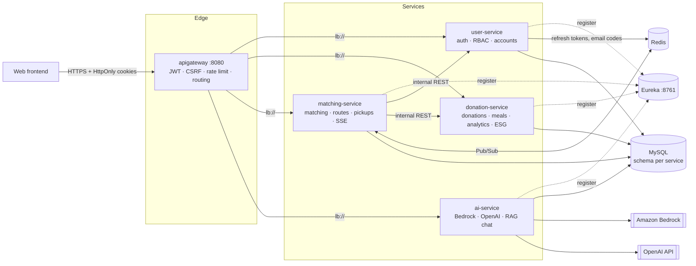
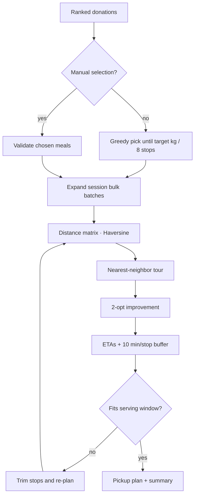
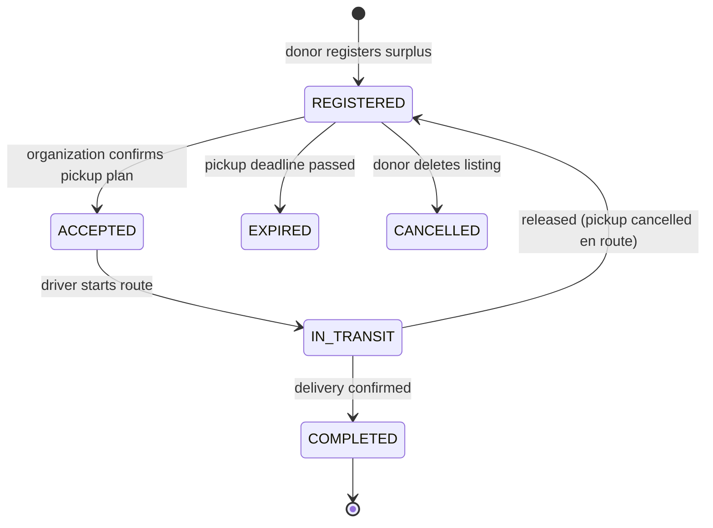
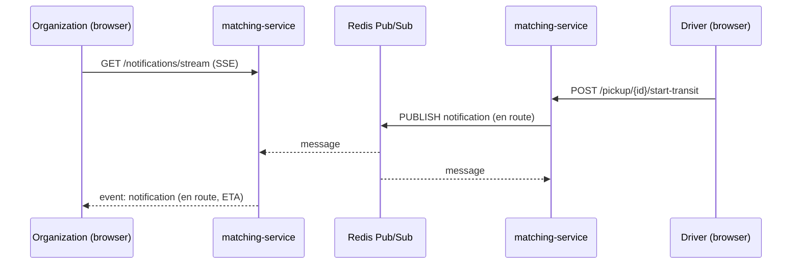
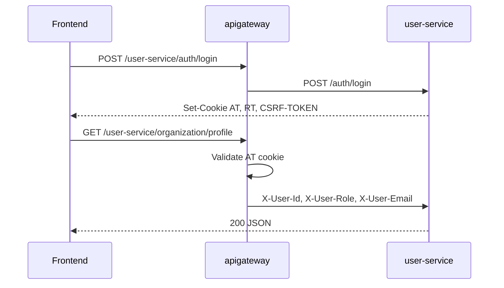

<div align="center">

# 🍱 MealBridge

**Turning surplus institutional meals into same-day donations.**

MealBridge connects kitchens that cook at scale (military units, schools, public offices) with nearby welfare organizations.
Donors register leftovers in seconds, organizations get ranked recommendations and an optimized pickup route,
and everyone sees the food move from *registered* to *delivered* in real time.


</div>

---

## Table of contents

1. [The problem](#the-problem)
2. [What MealBridge does](#what-mealbridge-does)
3. [Architecture](#architecture)
4. [Feature deep dives](#feature-deep-dives)
   - [Weighted donation matching](#1-weighted-donation-matching)
   - [Pickup planning and route optimization](#2-pickup-planning-and-route-optimization)
   - [Donation lifecycle](#3-donation-lifecycle)
   - [Real-time notifications](#4-real-time-notifications)
   - [Gateway security](#5-gateway-security)
   - [AI features](#6-ai-features)
   - [Kitchen analytics, leftover prediction, and ESG](#7-kitchen-analytics-leftover-prediction-and-esg)
5. [Services and API overview](#services-and-api-overview)
6. [Tech stack](#tech-stack)
7. [Design decisions](#design-decisions)
8. [Getting started](#getting-started)
9. [Testing](#testing)
10. [Roadmap](#roadmap)

---

## The problem

Large institutional kitchens cook for hundreds or thousands of people every day, and a predictable share of that food is thrown away. At the same time, welfare organizations a few kilometers away need meals. The food is safe for only a few hours, so the hard part is not goodwill but **logistics**: who should get which batch, in what order should a driver collect it, and how does everyone know where it is right now.

## What MealBridge does

| For donors (kitchens) | For organizations (recipients) | For admins |
|---|---|---|
| Register a meal from a **photo** (AI dish recognition) or manually | See donations **ranked by fit** (distance, capacity, deadline, area) | Approve or reject new donor / organization accounts |
| Track meal sessions, headcount, and waste over time | Ask for a **pickup plan** that fits a target weight and serving time | Manage admin and platform users |
| Get a **leftover forecast** before serving | Get a **2-opt optimized multi-stop route** with ETAs | Receive warnings when pickups go wrong |
| Download an **ESG report** (food diverted, CO₂e avoided, cost saved) | Receive **live notifications** as pickups are confirmed, en route, and completed | |

---

## Architecture



- **6 independently built Gradle modules**: 4 domain services, an API gateway, and a service registry.
- **Database per service**: one MySQL instance with four isolated schemas (`mealbridge_user`, `mealbridge_donation`, `mealbridge_matching`, `mealbridge_ai`). No service reads another service's tables; they call each other's `/internal/**` endpoints instead.
- **Zero fixed ports for business services**: each one starts on a random port, registers with Eureka, and is reached through `lb://service-name`, so you can run several instances side by side.

---

## Feature deep dives

### 1. Weighted donation matching

`matching-service › RecommendationService` scores every (donation, organization) pair on four normalized signals and ranks the results:

| Signal | Weight | How it is computed |
|---|---|---|
| Distance | **35%** | Haversine distance between donor and organization, `1 / (1 + km)` |
| Capacity fit | **25%** | Estimated portions (`weight ÷ 0.3 kg`) vs. the organization's recipient capacity; full score when it fits, decaying when it overflows |
| Deadline urgency | **25%** | Higher for donations that expire sooner (`1 − 0.7 · hours/24`), zero once expired |
| Service area | **15%** | Text match between the organization's service area and the donor address / notes |

```
score = 100 × (0.35·distance + 0.25·capacity + 0.25·deadline + 0.15·serviceArea)
```

Candidates beyond the organization's **maximum pickup radius** are filtered out before planning, and each ranking is persisted for later lookup.

### 2. Pickup planning and route optimization

When an organization asks for a pickup plan (`POST /matching/pickup-plan/suggest`), MealBridge:

1. Takes the ranked donations and greedily selects meals until the **desired pickup weight** is reached (max **8 stops**).
2. Expands "session bulk" donations so batches from the same meal session are picked up together.
3. Builds a **Haversine distance matrix** with the organization as the depot.
4. Seeds a tour with **nearest neighbor**, then improves it with **2-opt** (reverse any segment whose swap shortens the tour, until no move helps).
5. Converts each leg into a duration (30 km/h average) plus a **10-minute buffer per stop**, and estimates the round trip.
6. **Trims stops** that would make the driver miss the organization's serving start time, and explains why in a human-readable summary.



Confirming the plan (`/pickup-plan/confirm`) creates assignments, stores a `RoutePlan` with total distance and duration, and links every stop to tracking.

### 3. Donation lifecycle



Every transition is guarded inside the `Donation` entity (e.g. only `REGISTERED` donations can be accepted, and only if they are still within the pickup window), so an invalid jump throws instead of corrupting state. A scheduler in `donation-service` runs **every 60 seconds** and auto-expires listings whose pickup deadline has passed, so organizations never plan around food that is no longer safe.

### 4. Real-time notifications

Users subscribe once to `GET /notifications/stream` (**Server-Sent Events**, 30-minute timeout). Pickup events (confirmed, en route, completed, cancelled) are published to a **Redis Pub/Sub** channel, and every `matching-service` instance pushes them to the users connected to it. That way notifications work no matter which instance a user's SSE connection landed on.



Notifications are also stored, with unread counts and read / read-all endpoints. When Redis is turned off (`mealbridge.notifications.redis.enabled=false`) an in-process broadcaster is used instead, which keeps local development simple.

### 5. Gateway security

- **JWT validated once** at the gateway from HttpOnly cookies; downstream services receive trusted `X-User-Id` / `X-User-Role` headers.
- **Internal secret header**: services reject protected requests that did not come through the gateway, so hitting a service's random port with forged headers fails.
- **Double-submit CSRF** (`CSRF-TOKEN` cookie + `X-CSRF-Token` header) on every mutating request.
- **Per-IP rate limiting** on login and registration (30 requests / minute by default).
- **4 roles** (`SUPER_ADMIN`, `ADMIN`, `ORGANIZATION`, `DONOR`) checked against the database, not just the token.
- **Email verification** (6-digit code over Gmail SMTP, stored in Redis for 30 minutes) and **admin approval** before an account can log in.

### 6. AI features

All model calls live in `ai-service`, so other services never hold API keys.

| Feature | Endpoint | How it works |
|---|---|---|
| Meal photo analysis | `POST /vision/analyze` | Sends the image to **Amazon Bedrock (Nova Lite, Converse API)** in one of three modes: `MEAL_REGISTER` (dish list with main / side / soup and ingredients), `SERVING`, and `LEFTOVER` (estimated kg). The model must answer in strict JSON, and a repair step fixes common malformed output (e.g. extra closing brackets) before parsing. |
| Portal chat assistant | `POST /chat` | Retrieves the top 3 chunks from a small markdown knowledge base (pickup guide, procurement guide, waste-reduction tips, allergy labeling) by keyword scoring, filtered by portal (donor vs. organization), and grounds a Bedrock answer on them with cited sources. |
| Procurement advisor | `POST /procurement/advise` | Turns consumption and waste statistics into a short purchasing briefing with Bedrock. |
| Meal item enrichment | `POST /text/enrich-meal-items` | Uses OpenAI `gpt-4o-mini` to fill in nutrition details for meal line items. |

Every AI feature has a **mock mode** (`AI_MOCK`, `OPENAI_MOCK`), so the whole platform runs locally without cloud credentials or billing.

### 7. Kitchen analytics, leftover prediction, and ESG

- **Meal sessions and plans**: donors log each service (headcount, menu, weather snapshot) and plan menus in bulk.
- **Analytics**: daily aggregates are rebuilt every 5 minutes for statistics and trend views.
- **Leftover prediction** (`POST /meal-sessions/predict-leftover`): a similarity-weighted nearest-neighbor model over the last **2 years** of the kitchen's own sessions. Each past session is scored on menu overlap (Jaccard, 30%), headcount (25%), same weekday (20%), and weather / temperature / humidity (25%); the top 5 matches are blended into waste per person × today's headcount, and the matching sessions are returned so the forecast is explainable.
- **Procurement suggestions**: recommends quantities from historical consumption.
- **ESG report** (`GET /esg/report`): food diverted from landfill, **CO₂e avoided** using the EPA WARM factor (0.49 kg CO₂e per kg of food), and disposal cost saved, ready for institutional reporting.

---

## Services and API overview

| Module | Responsibilities | Main endpoints |
|---|---|---|
| `eureka` (8761) | Service discovery | Dashboard at `/` |
| `apigateway` (8080) | Routing, CORS, JWT, CSRF, auth rate limit | `/{service-name}/**` |
| `user-service` | Signup with email verification, admin approval, login / refresh / logout, accounts and profile images, admin and platform-user management | `/auth/**`, `/account/**`, `/admin/**`, `/organization/profile`, `/donor/profile` |
| `donation-service` | Donations and their lifecycle, meal sessions and plans, statistics and analytics, leftover prediction, procurement suggestions, weather, ESG | `/donations/**`, `/meal-sessions/**`, `/meal-plans/**`, `/procurement/suggestions`, `/weather/current`, `/esg/report` |
| `matching-service` | Recommendations, assignments, route optimization, pickup plans and tracking, notifications | `/matching/**`, `/notifications/**` |
| `ai-service` | Vision analysis, chat assistant, procurement advice, meal-item enrichment | `/vision/analyze`, `/chat`, `/procurement/advise`, `/text/enrich-meal-items` |

Every response uses one envelope (snake_case):

```json
{ "status_code": 200, "status_message": "Login successful", "result": { } }
```

---

## Tech stack

| Layer | Technology |
|---|---|
| Language & framework | Java 17, Spring Boot 3.4, Spring Data JPA |
| Microservices | Spring Cloud Gateway, Netflix Eureka, RestTemplate / RestClient |
| Data | MySQL (schema per service), Redis (refresh tokens, verification codes, Pub/Sub) |
| Real time | Server-Sent Events + Redis Pub/Sub |
| Security | JWT (HS512) in HttpOnly cookies, double-submit CSRF, RBAC, gateway internal secret, rate limiting |
| AI | Amazon Bedrock (Nova Lite, Converse API), OpenAI `gpt-4o-mini`, keyword-retrieval RAG |
| Infra & tooling | Docker Compose, Gradle, Postman collection, JUnit |

---

## Design decisions

- **Validate tokens once, at the edge.** The gateway owns JWT parsing; services stay simple and only trust headers that carry the gateway's internal secret.
- **Redis Pub/Sub for fan-out instead of sticky sessions.** SSE connections are long-lived and tied to one instance; publishing through Redis lets any instance deliver any event.
- **Heuristic routing over an external solver.** With at most 8 stops per route, nearest neighbor + 2-opt is fast, dependency-free, and close to optimal, and it runs inside the request.
- **Explainable predictions.** The leftover forecast returns the past sessions it was based on, so kitchen staff can see *why* the number is what it is.
- **Mock-first AI.** Every model call can be switched to deterministic mock output, which keeps local development and demos free and reliable.

---

## Getting started

### Prerequisites

- **JDK 17+**
- **Docker** (MySQL + Redis for local auth)
- **Git Bash** (optional, for `setup-local-config.sh`)

### Local configuration

`application-local.yml` is **gitignored**. After cloning, generate it once:

```bash
bash scripts/setup-local-config.sh
```

To reset local YAML from examples (e.g. after pulling JWT secret updates):

```bash
bash scripts/setup-local-config.sh --sync
```

**Manual copy (per module):**

```bash
cp apigateway/src/main/resources/application-local.yml.example apigateway/src/main/resources/application-local.yml
cp user-service/src/main/resources/application-local.yml.example user-service/src/main/resources/application-local.yml
# donation-service, matching-service, ai-service — same pattern
```

`eureka` uses `application.yml` only (no `local` profile file).

**Important:** `jwt.secretKeyAt` in `user-service` and `apigateway` must match. Default examples use **HS512-ready 64-byte** secrets (Base64-encoded). Override via `JWT_SECRET_AT` / `JWT_SECRET_RT` only if values are at least 512 bits.

### Infrastructure (local)

```bash
docker compose up -d
bash scripts/setup-local-config.sh --sync
```

| Service | Host | Notes |
|---------|------|--------|
| MySQL | `localhost:13306` | Maps to container `3306`; user/pass `mealbridge` / `mealbridge` |
| Redis | `localhost:6379` | Refresh token store for `user-service` |

#### MySQL databases (one instance, four schemas)

| Service | JDBC database |
|---------|----------------|
| `user-service` | `mealbridge_user` |
| `donation-service` | `mealbridge_donation` |
| `matching-service` | `mealbridge_matching` |
| `ai-service` | `mealbridge_ai` |

On first startup, [`docker/mysql/init/01-schemas.sql`](docker/mysql/init/01-schemas.sql) creates all four databases.

If you previously ran an older single-database setup, re-run init:

```bash
docker compose down -v
docker compose up -d
```

### Build (per module)

```bash
cd eureka && ./gradlew build
cd ../apigateway && ./gradlew build
cd ../user-service && ./gradlew build
# donation-service, matching-service, ai-service — same
```

Windows: use `gradlew.bat build`.

### Run order (local)

1. `docker compose up -d`
2. `eureka` (8761)
3. `user-service`, `donation-service`, `matching-service`, `ai-service`
4. `apigateway` (8080)

Activate profile **`local`** in your IDE or:

```bash
./gradlew bootRun --args='--spring.profiles.active=local'
```

#### Health checks (via gateway)

- http://localhost:8080/user-service/health
- http://localhost:8080/donation-service/health
- http://localhost:8080/matching-service/health
- http://localhost:8080/ai-service/health

Frontend dev server (CORS allowed): http://127.0.0.1:3000

### Authentication

#### Flow



- **Access token (`AT`)** — HttpOnly cookie; validated at the gateway.
- **Refresh token (`RT`)** — HttpOnly cookie; stored in Redis (in-memory fallback in `test` profile).
- **CSRF** — double-submit: cookie `CSRF-TOKEN` + header `X-CSRF-Token` on mutating requests (gateway `CsrfFilter`).

#### Roles

| Role | Description |
|------|-------------|
| `ORGANIZATION` | Receiving organization (e.g. welfare center) |
| `DONOR` | Food donor institution (military unit, school, public office, etc.) |
| `SUPER_ADMIN` | Top admin — CRUD for subordinate `ADMIN` accounts |
| `ADMIN` | Sub-admin, created by `SUPER_ADMIN` |

#### Email verification (Gmail SMTP)

Registration requires a verified email when `mealbridge.email-verification.enabled=true` (default in `application-local.yml.example`).

1. `POST /user-service/auth/email/verification/send` — `{ "email": "you@example.com" }` sends a 6-digit code (Gmail SMTP).
2. `POST /user-service/auth/email/verification/confirm` — `{ "email": "...", "code": "123456" }` marks the address verified in Redis (30 min).
3. `POST /user-service/auth/register/organization` or `/register/donor` — rejected until step 2 succeeded for that email.

**Gmail setup (local):**

1. Google Account → Security → turn on **2-Step Verification**.
2. Create an **App password** (Mail / Other) and copy the 16-character value.
3. In `user-service` environment or shell:

```bash
export GMAIL_USERNAME=your-account@gmail.com
export GMAIL_APP_PASSWORD=xxxx-xxxx-xxxx-xxxx
```

4. Copy `application-local.yml.example` → `application-local.yml` (mail section is included).

**Dev without Gmail:** set `EMAIL_VERIFICATION_DEV_CODE=123456` — the server always uses that code and logs it; the UI flow stays the same.

#### Registration and approval

1. **Email verification** (if enabled) — send + confirm code for the signup email.
2. **Public signup** — `POST /user-service/auth/register/organization` or `/auth/register/donor` → account `PENDING` (no cookies).
3. **SUPER_ADMIN** lists `GET /user-service/admin/registrations/pending`, reviews detail, then `PATCH .../approve` or `.../reject`.
4. After approval, user can **login** normally.

**ADMIN accounts** are not self-registered; `SUPER_ADMIN` creates them via `POST /user-service/admin/users`.

#### Authorization (gateway header pattern)

- **API Gateway** validates JWT (cookies) and injects `X-User-Id` / `X-User-Role` on downstream requests.
- **user-service** has no Spring Security filter chain. Protected controllers call `AuthHeaders`: verifies **ACTIVE** user in DB, **role header matches DB role**, and required role per endpoint.
- **Gateway internal secret** — after JWT validation, gateway adds `X-Gateway-Internal-Secret`. Each service rejects protected routes without the matching secret (blocks direct Eureka port access with forged headers). Public routes: `/health`, `/auth/**`.
- **Auth rate limit** — gateway limits `/auth/login` and `/auth/register/**` per client IP (default 30/min).
- **Access token TTL** — default 1 hour (`jwt.expirationAt`); refresh via `RT` cookie.
- **donation-service** uses a lightweight `AuthHeaders` copy (no user DB); sample `GET /donations/me` requires `ORGANIZATION` or `DONOR` role header + gateway secret.
- **Production** — set `JWT_SECRET_AT`, `JWT_SECRET_RT`, and `GATEWAY_INTERNAL_SECRET` (same value on gateway and all services). Do not expose service ports publicly.

#### Gateway API reference (prefix `/user-service`)

| Method | Path | Access |
|--------|------|--------|
| POST | `/user-service/auth/email/verification/send` | Public |
| POST | `/user-service/auth/email/verification/confirm` | Public |
| POST | `/user-service/auth/register/organization` | Public (email verified) |
| POST | `/user-service/auth/register/donor` | Public (email verified) |
| POST | `/user-service/auth/login` | Public |
| POST | `/user-service/auth/refresh` | Public (valid `RT` cookie) |
| POST | `/user-service/auth/logout` | Authenticated |
| GET | `/user-service/admin/registrations/pending` | `SUPER_ADMIN` |
| GET | `/user-service/admin/registrations/{userId}` | `SUPER_ADMIN` |
| PATCH | `/user-service/admin/registrations/{userId}/approve` | `SUPER_ADMIN` |
| PATCH | `/user-service/admin/registrations/{userId}/reject` | `SUPER_ADMIN` |
| GET | `/user-service/organization/profile` | `ORGANIZATION` |
| GET | `/user-service/donor/profile` | `DONOR` |
| GET | `/user-service/admin/users` | `SUPER_ADMIN` |
| POST | `/user-service/admin/users` | `SUPER_ADMIN` |
| PATCH | `/user-service/admin/users/{id}/status` | `SUPER_ADMIN` |
| GET | `/user-service/admin/users/me` | `ADMIN` |
| GET | `/donation-service/donations/me` | `DONOR` (sample; role checked in service) |

#### Frontend integration

- Send cookies: `credentials: 'include'`
- On POST/PUT/PATCH/DELETE: header `X-CSRF-Token` = cookie `CSRF-TOKEN` value
- Do not set `X-User-Id` / `X-User-Role` from the client — the gateway sets them after JWT validation

#### Seed users (`mealbridge.auth.seed-enabled=true`, `local` profile)

| Email | Role | Password |
|-------|------|----------|
| `super@mealbridge.local` | `SUPER_ADMIN` | `mealbridge123!` |
| `admin@mealbridge.local` | `ADMIN` | `mealbridge123!` |
| `org@mealbridge.local` | `ORGANIZATION` | `mealbridge123!` |
| `donor@mealbridge.local` | `DONOR` | `mealbridge123!` |

### Postman

Import:

- [`postman/MealBridge-Local.postman_collection.json`](postman/MealBridge-Local.postman_collection.json)
- [`postman/MealBridge-Local.postman_environment.json`](postman/MealBridge-Local.postman_environment.json)

Details: [`postman/README.md`](postman/README.md).

Suggested flow: **Health** → **Login** → role folders → negative tests.


---

## Testing

```bash
cd user-service && ./gradlew test   # repeat per module
```

Current tests cover user registration (integration), security error handling, the gateway internal-auth filter, vision JSON repair, and application context loading for every module.

---

## Roadmap

- [ ] Kafka-based domain events between services (today: synchronous internal REST)
- [ ] Broader automated test coverage for matching and route planning
- [ ] Apply the gateway-trust check uniformly across all services
- [ ] Containerize every service in Docker Compose for one-command startup

## Branching

| Branch | Contents |
|---|---|
| `develop` | Integration branch |
| `feature/*`, `fix/*`, `refactor/*` | Topic branches merged into `develop` |
